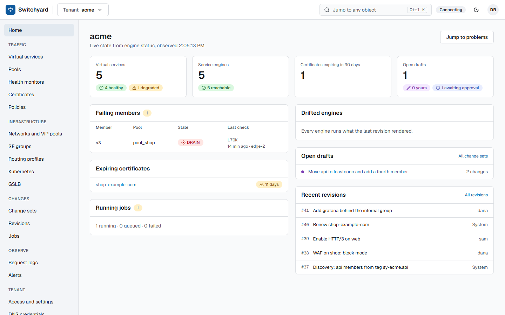
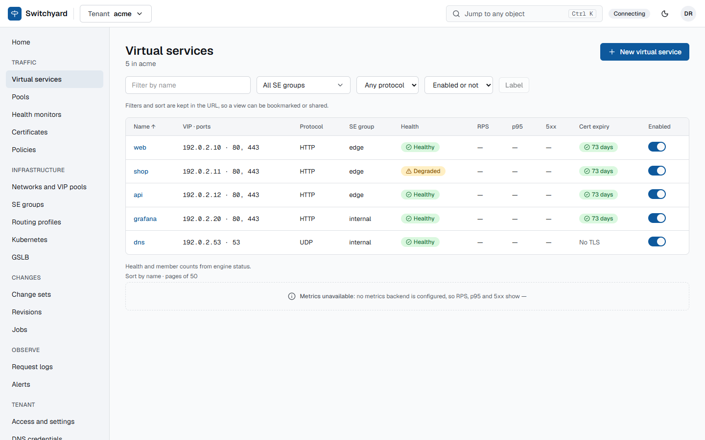
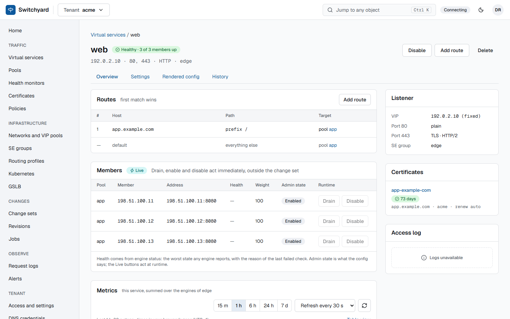
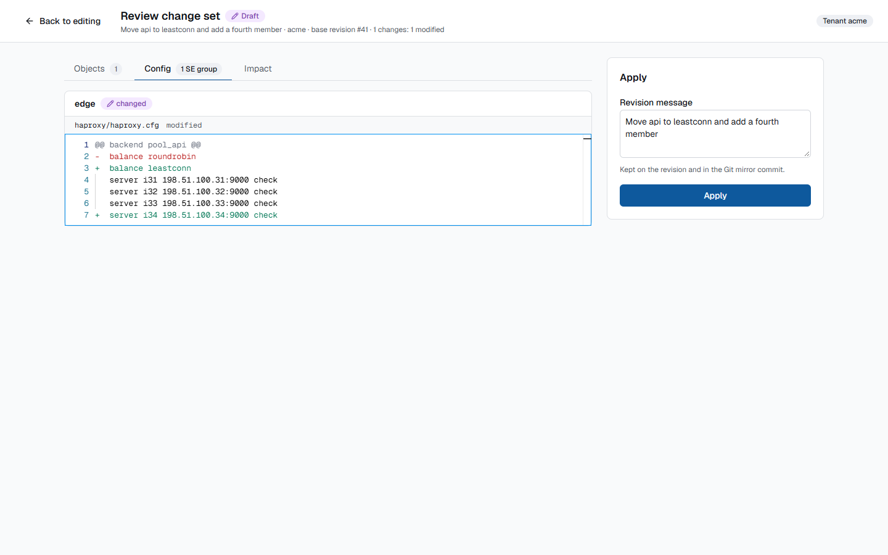
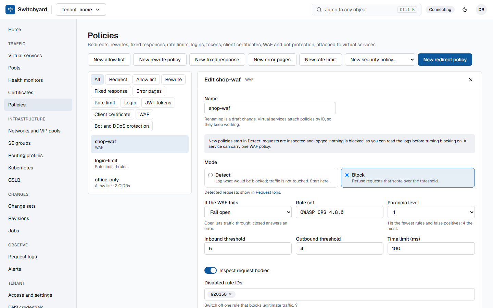

# Switchyard

Multi-tenant load balancer controller for Proxmox: HAProxy service engines, BGP/VRRP VIP placement, and a
change-set based API, CLI (`syctl`) and web UI. An open-source replacement for VMware NSX ALB (Avi).

**Status:** the phase 1 backend (M1 to M5) and M6 (UDP through Keepalived/IPVS) are built, with the web UI on top. Since then:
policies (rewrites, fixed responses, rate limits, persistence kinds, HTTP/3 and gRPC, compression and cache), the WAF
(Coraza with OWASP CRS), logins in front of services (OIDC, LDAP/SAML directories, JWT, client certificates), bot and DDoS
protection, alerting, telemetry, GSLB on PowerDNS, a Kubernetes connector, pool discovery from Proxmox tags, an Avi importer
and an OpenTofu provider. The [feature notes](docs/features/index.md) list what each does and where it stops; the
[lab results](docs/lab/2026-10-12-full-pass.md) show what was run on real Proxmox hosts. Not built: multi-site with remote
engines ([ADR 0180](docs/adr/0180-multi-site-and-remote-engines.md), proposed). The controller runs on Docker Compose, in Proxmox VMs or
privileged LXC containers, or on Kubernetes with a Helm chart; see the [production guide](docs/production.md).

## Screenshots

| | |
| --- | --- |
|  |  |
| Tenant home | Virtual services |
|  |  |
| A virtual service | Reviewing a change set before apply |
|  |  |
| An SE group's engines | Policies (WAF shown) |

The screenshots use a demo dataset against a mocked API; `make ui-screenshots` refreshes them.

## Documentation

The docs build into a site with `make docs` (MkDocs Material, [ADR 0190](docs/adr/0190-docs-site-mkdocs-material.md)); they
also read fine here.

| Doc | What it covers |
| --- | --- |
| [Quickstart](docs/quickstart.md) | Stand up a test instance on its own machine, connect Proxmox, deploy a first engine |
| [Production guide](docs/production.md) | Deployment options, network and ports, sizing, security checklist, OpenBao, backups, monitoring, upgrades, what is proven |
| [Feature notes](docs/features/index.md) | One page per feature: what, how to use, limits |
| [Whitepapers](docs/whitepapers/index.md) | Architecture, security model, HA and the data plane, multi-tenancy |
| [Why it works this way](docs/why.md) | Questions answered by the decision records |
| [Operating guide](docs/operating.md) | Processes, configuration, login, `syctl api`, agents, housekeeping |
| [Runbooks](docs/runbooks/README.md) | Restore the database, rotate the CA, replace or upgrade engines, roll back, lab hosts |
| [API conventions](docs/api.md) | Auth, errors, filters, pagination, health, live events, metrics; live docs at `/api/v1/docs` and `/api/v1/redoc` |
| [Render guide](docs/render.md) | How each object maps to HAProxy configuration |
| [OpenTofu provider](provider/README.md) | Manage a tenant with OpenTofu; generated from the OpenAPI |
| [Design docs](docs/design/01-replacement-plan.md) | Replacement plan, backend and frontend design, planned vs built, parity plan |
| [ADRs](docs/adr/README.md) | Every decision locked in so far |
| [Lab results](docs/lab/2026-10-12-full-pass.md) | What was run on two real Proxmox hosts and what it showed |

## Developing on Windows

Everything runs from PowerShell 7. Linux-only tools (HAProxy, PostgreSQL, FRR, Keepalived) run in Docker, so Docker
Desktop (WSL2 backend) is the only extra requirement. No `make` is needed.

```powershell
winget install astral-sh.uv          # uv downloads Python 3.12 itself
cd controller
uv sync                              # create .venv and install locked dependencies
uv run ruff check .                  # lint            (make lint)
uv run ruff format --check .         #                 (make lint)
uv run mypy                          # type check      (make typecheck)
uv run pytest                        # tests           (make test)
docker compose -f ../deploy/dev/compose.yaml up -d --wait   # local PostgreSQL 17 (make db-up)
uv run pre-commit install            # optional: run the gates on commit (from the repo root)
```

From the repo root: `uvx --with-requirements docs/requirements.txt mkdocs build --strict` builds the docs site and checks
every link (`make docs`); `mkdocs serve` with the same prefix previews it.

Notes:

- Tests that need PostgreSQL or HAProxy start their own containers with testcontainers, so they behave the
  same on Windows, WSL2 and CI. Run `uv run pytest -m "not docker"` for the fast, Docker-free subset.
- Line endings are LF (`.gitattributes`). Keep `core.autocrlf` off or `input` for this repo.
- On Linux/macOS or WSL2, `make -C controller check` runs all gates, same as `.gitlab-ci.yml`; run them
  (and `make docs`) locally before pushing a merge request.
- CI runs in two tiers: every push and merge request gets lint, types, docs, the Docker-free tests and a container smoke
  set; the full container suite and the coverage gate run on main, on `v*` tags, nightly, or with `FULL_TESTS=1`.
- The UI (`ui/`, Node 22 and pnpm) has its own targets in the root `Makefile` (`make ui-check`); see [docs/ui/README.md](docs/ui/README.md).

## Working with Claude Code

- `CLAUDE.md`: project rules and conventions Claude Code follows.
- `docs/prompts/`: prompts that started milestones.

## License

TBD.
