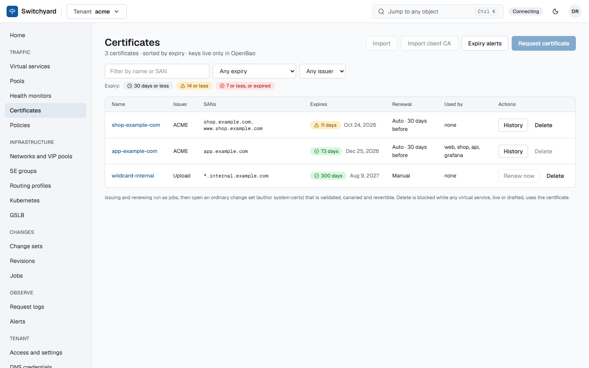

# Certificates and ACME

**What.** Server certificates for TLS ports, from four sources: imported (PEM or PKCS#12), issued by an ACME CA (Let's
Encrypt, ZeroSSL, step-ca and others; DNS-01, HTTP-01 or TLS-ALPN-01), Cloudflare Origin CA, or replaced in place. Keys live
in OpenBao; PostgreSQL holds only a reference.

**How to use.**

- Import: `POST .../certificates/import` with the PEM or a `.p12` and its password.
- Issue: `POST .../certificates/issue/check` (preflight: names, DNS provider, challenge), then `POST .../certificates/issue`.
  ACME accounts are `acme-providers` (system-wide, with presets); DNS credentials are per-tenant `dns-providers`
  (Cloudflare, Route 53, Azure, Google, RFC 2136, PowerDNS).
- Renewal is automatic for issued certificates, `renew_before_days` (default 30) before expiry; `POST .../{certificate}/renew`
  forces one, and `GET .../certificate-renewals` shows the history.
- `POST .../{certificate}/replace` swaps the material under the same object, so every service using it follows.
- Get told before anything expires with a `cert_expiry` [alert rule](alerting.md).

**Limits.** Imported (`manual`) certificates are never renewed by the controller. A key never appears in a change set, an
API answer, Git or the database. The full guide: [ACME and certificates](../acme.md).

**Decisions:** [0010](../adr/0010-certificates-and-cloudflare.md), [0043](../adr/0043-pkcs12-certificate-import.md),
[0044](../adr/0044-replace-certificate-in-place.md), [0064](../adr/0064-certificate-renew-before-days.md),
[0080](../adr/0080-acme-providers-and-dns-credentials.md), [0082](../adr/0082-tls-alpn-01.md).
