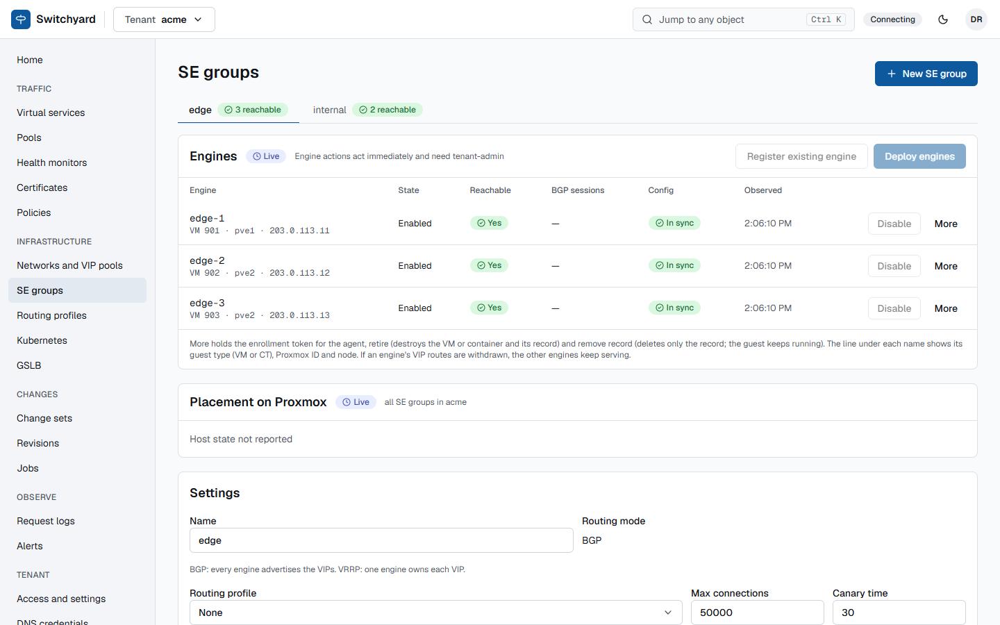

# Engines on Proxmox

**What.** Service engines (SEs) are Proxmox guests cloned from a prepared template: HAProxy with the Data Plane API, FRR,
Keepalived, `sy-agent` and the optional sidecars (Coraza, oauth2-proxy, Vector). The controller creates them, gives them
addresses from VIP pools, enrols their agent, and retires them.

**How to use.**

- Build the template once: [Build the SE template](../runbooks/build-se-template.md).
- Deploy a group: `POST .../se-groups/{group}/deploy` with `count`, `nodes`, `template_vmid`, `mgmt_pool_id`,
  `credentials_ref` and `guest_kind` (`vm` by default, `lxc` when a system administrator allowed it). `GET
  .../se-groups/{group}/placement` shows the hosts and their capacity.
- Engines can also be registered by hand and enrolled with a one-time token (`.../engines/{engine}/enrollment-token`).
- Scale out by deploying more, then `POST .../se-groups/{group}/reapply`. Replace an image with the
  [rolling upgrade](../runbooks/rolling-upgrade.md) runbook; retire with `POST .../engines/{engine}/retire`.
- `GET .../status/se-groups` gives a health score per group with the reasons.

**Limits.** Only guests flagged as Proxmox templates are cloned. VM engines are the supported default; privileged LXC
containers work and need the system setting `allow_lxc_guests`; unprivileged containers were only tried for VRRP. The
controller never opens SSH to an engine: the agent writes only under `/etc/switchyard/` and reloads an allowlisted set of
units.

**Decisions:** [0009](../adr/0009-infrastructure-jobs.md), [0011](../adr/0011-agent-enrollment.md),
[0049](../adr/0049-proxmox-host-state-and-placement.md), [0050](../adr/0050-se-image-recipe.md),
[0055](../adr/0055-guest-kind-vm-or-lxc.md), [0075](../adr/0075-deploy-hardening.md),
[0076](../adr/0076-lxc-guests-setting.md), [0083](../adr/0083-se-image-sidecar-slot-and-rolling-operations.md).
