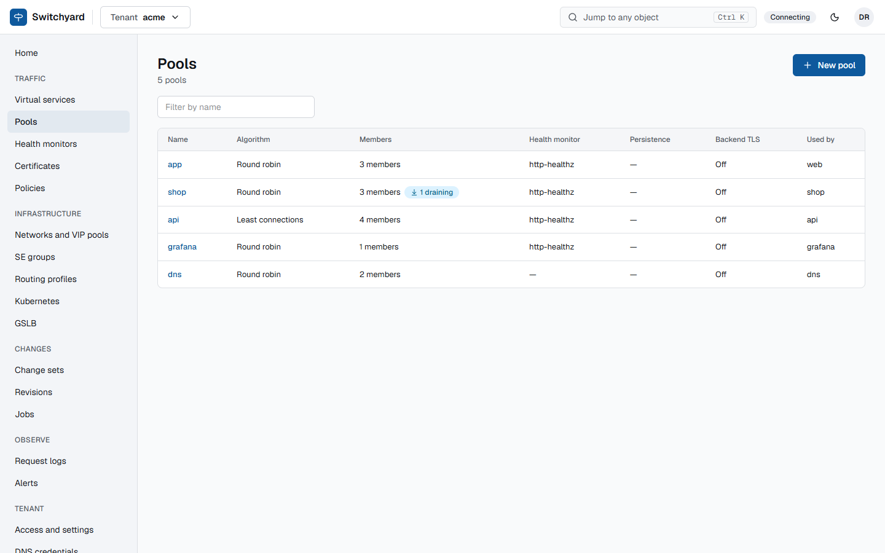

# Pools and members

**What.** A pool is a set of backend members, an algorithm (`roundrobin`, `leastconn`, `source` or `random`) and how to talk
to the members.



**How to use.**

```yaml
name: api
algorithm: leastconn
health_monitor_id: <monitor id>
tls: true                    # connect to members over TLS
tls_verify: true             # check their certificate against the system CA store
client_certificate_id: <id>  # present a certificate to the members (backend mTLS)
send_proxy: v2               # PROXY protocol to members, and on health checks
members:
  - {name: api-1, address: 10.0.1.11, port: 8443, weight: 100}
  - {name: api-2, address: 10.0.1.12, port: 8443, maxconn: 500}
  - {name: api-dr, address: 10.9.1.11, port: 8443, backup: true}
```

- Member state is runtime, not a change set: `PUT .../pools/{pool}/members/{member}/state` with `enabled`, `drain` or
  `disabled` reaches every engine through the HAProxy Runtime API. See [health checks and drain](health-checks.md).
- A pool can be filled automatically from [Proxmox tags](pool-discovery.md) or a [Kubernetes cluster](kubernetes.md).

**Labels.** Virtual services and pools carry up to 20 free labels (`env: prod`, `team: payments`; keys and values are
`a-z`, `0-9`, `-`, `_`, `.`, at most 63 characters, a value may be empty). They are for finding objects: they never reach
a configuration file, so changing one does not touch the engines. Filter a list with `?label=env=prod`; repeat the
parameter to require all of them, and use `key`, `!key` or `key!=value` for has, has not and is not. An update replaces the
whole map. In the UI the Label box above the virtual services and pools lists takes the same selectors, comma
separated, and clicking a chip on a row adds it. Decision: [0198](../adr/0198-object-labels.md).

**Limits.** A pool used by a UDP service takes no TLS, persistence (other than the `source` algorithm), PROXY protocol, backup
members or `maxconn`, and no `random`: IPVS has no equivalent.

**Decisions:** [0106](../adr/0106-member-options-and-send-proxy.md), [0107](../adr/0107-backend-client-certificate.md).
