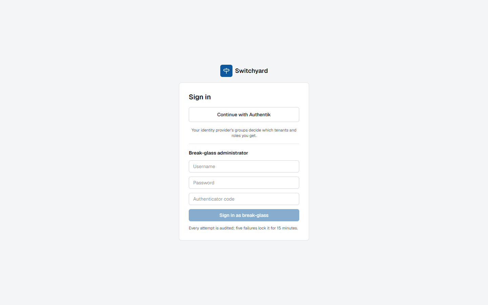

# Tenants, roles and sign-in

**What.** Each tenant owns its SE groups, networks, services, pools, certificates and policies. People sign in with OIDC or
SAML; their provider groups map to roles per tenant (`role-mappings`). Machines use API tokens. A break-glass account with
TOTP exists for emergencies and is off by default. The `management` tenant holds the controller's own service.

**How to use.** Configure identity providers (`/identity-providers`, with a test sign-in), map groups to roles, and give
automation a tenant token (`/tenants/{t}/tokens`). `GET /permissions` and `GET /me` tell a client what the caller may do.
Guides: [Signing in, roles and access](../auth.md), [Controller settings](../controller-settings.md).

**Limits.** Tenancy is enforced twice, in the service layer and by PostgreSQL row-level security, and cannot be switched off.
Tenant quotas cap objects and table sizes; a tenant administrator asks for more in [Usage and requests](quota-requests.md). Secret references must stay inside the tenant's own OpenBao path. Virtual services and pools
carry [labels](pools.md#labels) for grouping.

**Decisions:** [0002](../adr/0002-tenancy-rls.md), [0012](../adr/0012-user-login-and-sessions.md),
[0018](../adr/0018-saml-login.md), [0030](../adr/0030-rbac-matrix-and-access-lifecycle.md),
[0045](../adr/0045-tenant-quota-enforcement.md), [0071](../adr/0071-secret-reference-scope.md),
[0072](../adr/0072-hardening-engines-logins-secrets.md), [0155](../adr/0155-management-tenant-at-startup.md).
