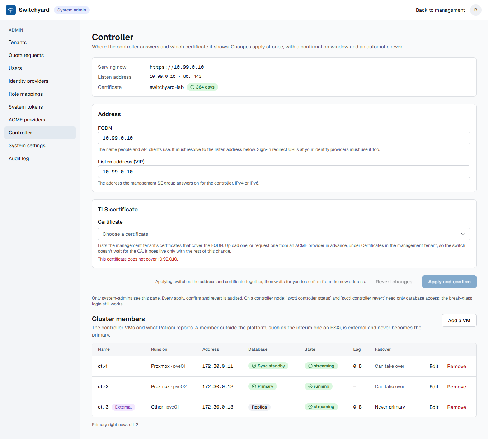
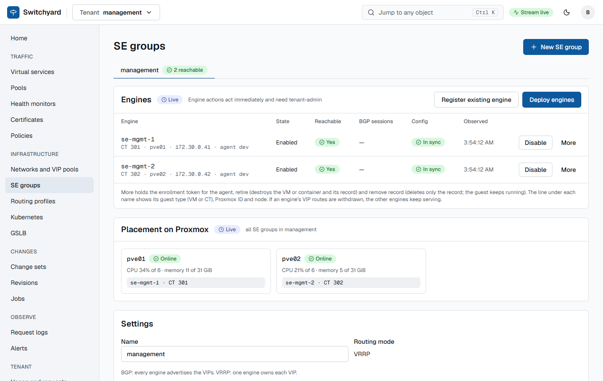
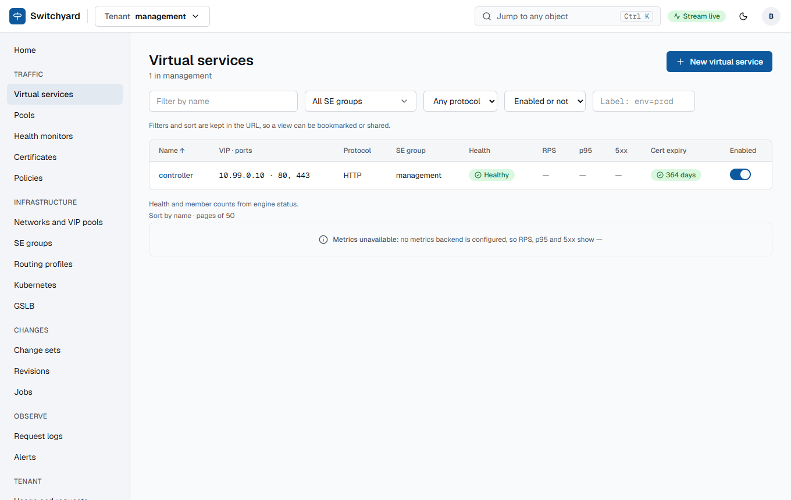
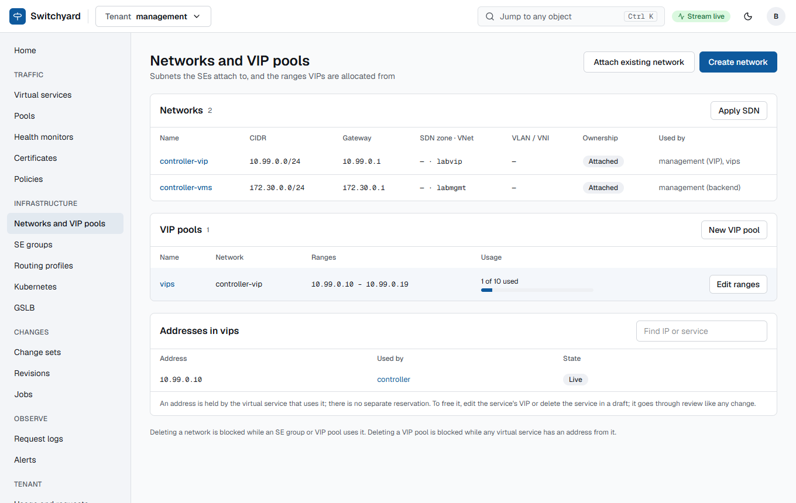
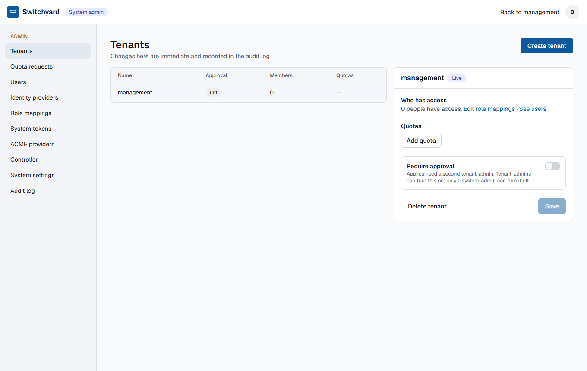
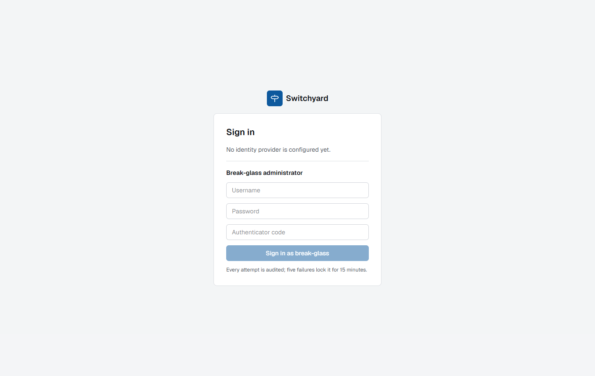
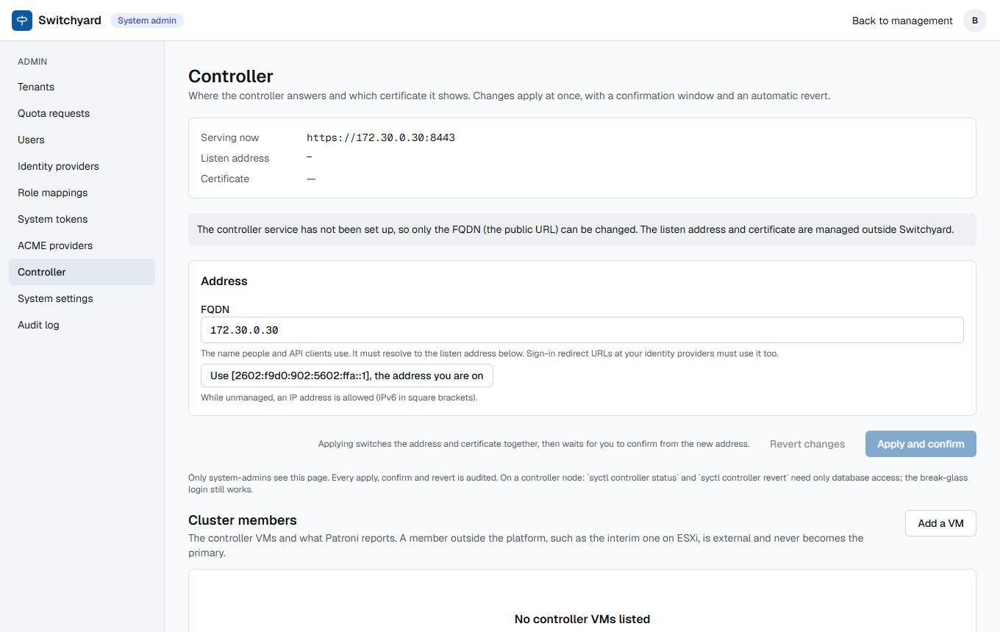
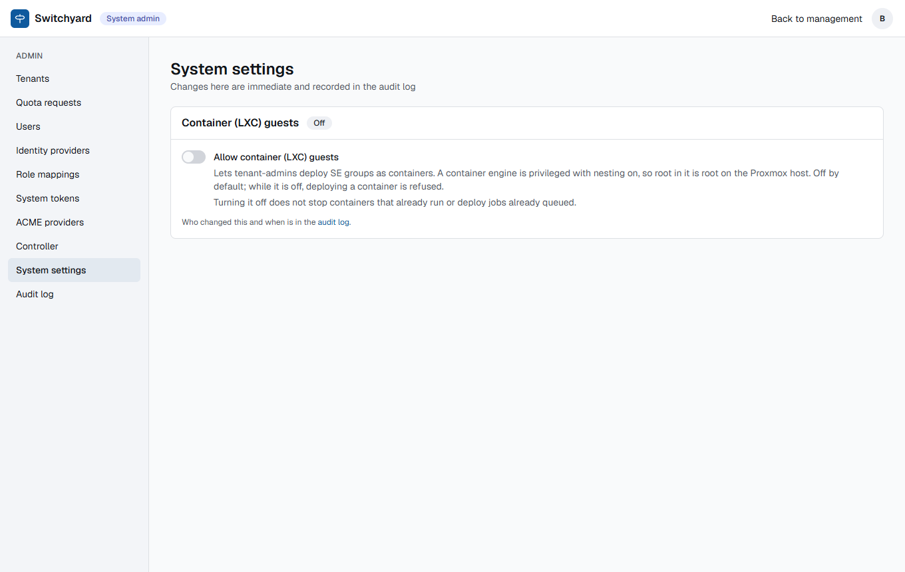

# Production deployment on the two-host Proxmox lab (2026-10-13)

A fresh "prod" install of the controller by every supported method, done as a new operator would, following
[production.md](../../production.md) and [deploy-kubernetes.md](../../deploy-kubernetes.md), on the two real Proxmox hosts of
[runbooks/lab-hosts.md](../../runbooks/lab-hosts.md). The lab was cleared first (the hosts, the k3s cluster and the engine
templates stayed). Every difference between the documents and reality was fixed in the same merge request; this page records
what was run, what it looked like, how long it took and what to watch for.

| Method | Where | Result |
| --- | --- | --- |
| [Docker Compose, three nodes (HA)](#a-docker-compose-ha-in-privileged-lxc-containers) | 3 privileged LXC containers on 2 hosts, OpenBao and S3 backup on two more | works; failover in under 5 s; hardened (below) |
| [Compose in a KVM VM](#b-compose-in-a-kvm-vm) | one Debian 13 cloud-image VM | works, with Docker from the distribution; one node only (the three-node shape is the LXC run) |
| [Helm on Kubernetes](#c-helm-on-k3s) | k3s, 2 nodes, CloudNativePG with 3 instances | works; database failover about 30 s |

All three ran the same controller image. The controller is the **management** tenant's own service in A: the controller VIP is
served by a Switchyard SE group, which is how a production install is meant to look
([production.md, section 1](../../production.md#1-shape-of-a-production-install)).

## A. Docker Compose HA in privileged LXC containers

### What was built

| Piece | Spec in the lab |
| --- | --- |
| `ctl-1`, `ctl-2` (pve01, pve02), `ctl-3` (pve01, tagged `nofailover`) | privileged LXC, nesting and keyctl, 2 vCPU, 4 GB RAM, 20 GB disk, Debian 13, `docker.io` and `docker-compose` from the distribution |
| `bao-1` | OpenBao 3 key shares, threshold 2, raft storage; KV v2, PKI mount with the roles `agents`, `controller` and `internal`; AppRole and the policy from `syctl openbao-policy` |
| `backup-1` | an S3-compatible store with TLS (SeaweedFS), the bucket for pgBackRest |
| `se-mgmt-1`, `se-mgmt-2` | the management SE group: two LXC engines cloned from the engine templates, VRRP on the controller VIP |
| Networks | management (nodes, engines, OpenBao), VIP network (the controller VIP), as overlays |

Resource use of one node with everything running: 400 MB of RAM in total for etcd, Patroni/PostgreSQL, API, worker and proxy
(API 165 MB, worker 117 MB, PostgreSQL 91 MB, etcd 26 MB), 4 GB of the 20 GB disk with 15 images, and a few percent of one CPU
when idle. 4 GB per node leaves plenty of room; the 2 vCPU matter more during applies and migrations.

### Order of work and how long each step took

1. **OpenBao** (about 10 minutes): initialise with shares, unseal, enable `kv` v2 and `pki`, create the roles
   (`use_csr_sans=false`, `use_csr_common_name=false` on `agents`), write the policy
   `syctl openbao-policy --shared kv/se/ --platform kv/proxmox/token | bao policy write switchyard-controller -`, create the
   AppRole, store the Data Plane credential at `kv/se/dataplane`.
2. **Backup repository**: bucket, key, and the cipher passphrase for pgBackRest (keep it; without it the backups are unreadable).
3. **Images**: built on a workstation and loaded with `docker load` because the nodes could not build (no Docker Hub, no npm):
   `switchyard-controller`, `switchyard-proxy` (the UI is built into it), `switchyard-patroni:17`, etcd and nginx. About 10
   minutes to build, 2 minutes to copy and load.
4. **Per node** (about 5 minutes each): the node certificate (`issue-node-cert.sh`), the Ed25519 bundle key, the controller's mTLS
   files, `node.env`, `sh firewall.sh --persist`.
5. **`docker compose --env-file node.env up -d` on the three nodes**: etcd forms in seconds, the first Patroni node
   initialises PostgreSQL, the other two join as replicas by `pgbackrest`/`basebackup`. All three streaming after about 3 minutes
   from empty; migrations run once (the others wait for the lock).
6. **First sign-in material**: `syctl token` from an API container (`docker compose exec api syctl token --name bootstrap`).
7. **`syctl adopt`** with the management file ([adopt/management.example.yaml](../../../deploy/prod/adopt/management.example.yaml)):
   networks, routing profile, the `management` SE group, the pool of the three nodes' proxy ports (8080), the `controller`
   virtual service on the VIP, the engines and the three controller members.
8. **Two engines** from the templates, enrolled with `enroll-engine.sh` (they must have addresses not used by anything else;
   see the gotchas).
9. **First apply** in the locked tenant: a draft change set that imports the certificate and moves the virtual service to 443
   with the HTTP redirect, applied with a break-glass reason. About 2 minutes including the canary.
10. **Public address**, Admin, Controller: the FQDN, VIP and certificate. The management SE group then answered
    `https://<VIP>/api/v1/healthz` with 200.
11. **Proxmox token** for deploying engines from the controller (role with only what the checklist lists), the secret in OpenBao at
    `kv/proxmox/token`, `PVE_URL`, `PVE_TOKEN_ID`, the Proxmox CA and `PVE_NAME`/`PVE_ADDR` in `node.env`.
12. **Backups**: `backup.sh` from cron on every node (it runs only on the primary); the first full backup, encrypted, in S3,
    WAL archiving verified with `pgbackrest info`.

### What it looks like

The Admin, Controller page: the serving address, the listen VIP with its ports, the certificate with its days left, and the
cluster members as Patroni reports them. `ctl-3` is the external member that never becomes primary.



The `management` tenant (locked: changes need a reason) with its SE group and the controller's own service:











### Securing the database tier, and the proof

The security review (finding D1, `docs/security/2026-10-13-review.md` on its branch) found etcd, Patroni's REST API and
PostgreSQL open to every host that could reach them. `deploy/prod` now ships them hardened
([production.md](../../production.md#securing-the-database-tier)). The whole three-node cluster was rebuilt with it (the database
was carried over with `pg_dump` and `pg_restore`; secrets live in OpenBao), and this was checked:

```text
# from a machine that is not a node (172.30.0.251 -> ctl-1)
2379 blocked/closed   2380 blocked/closed   8008 blocked/closed   5432 blocked/closed   8080 open

# from a node
etcd without a client certificate:            000 (handshake refused)
etcd with the node certificate:               {"health":"true","reason":""}
Patroni REST over plain http:                 000
Patroni switchover without the password:     no auth header received 401
pg_hba (select type,address,auth_method from pg_hba_file_rules):
  local trust | hostssl 172.30.0.11/12/13 scram-sha-256 (replication, then all) | hostssl 172.29.77.0 scram-sha-256
  | host 0.0.0.0/0 reject | host ::/0 reject
pg_stat_ssl: the replication connections are ssl=true
```

Failover with the hardened stack (leader `ctl-2`, stopped at 06:59:27; the sync standby took over before the first poll,
5 seconds later, timeline 2; the controller VIP kept answering):

```text
--- before   ctl-1 Replica | ctl-2 Leader | ctl-3 Sync Standby
t+5s    ctl-1 Leader running  timeline 2
--- after   ctl-1 Leader | ctl-3 Sync Standby ; healthz through the VIP: {"status":"ok"} 200
ctl-2 started again: Replica streaming, lag 0
patronictl switchover --leader ctl-1 --candidate ctl-3 --force: ctl-3 Leader, timeline 3
```

The `nofailover` tag (the ESXi-style member) was applied only after fixing the Compose file (Patroni has no environment variable for
tags, so `PATRONI_NOFAILOVER=true` had been ignored and a manual switchover to `ctl-3` succeeded). With the fix, stopping the
leader promoted `ctl-2` and `ctl-3` stayed a sync standby with `nofailover: true`. A full pgBackRest backup and WAL archiving
into S3 worked after the rebuild.

### Gotchas found, in the order you will meet them

- **Images**: the nodes cannot always build. Build once, `docker load` everywhere. The `proxy` and `patroni` services have a
  `build:` section; with prebuilt images set `CONTROLLER_IMAGE` and `PROXY_IMAGE`.
- **Docker client proxy**: a proxy set for the Docker client (`~/.docker/config.json`) is injected into the containers and the API's
  calls to OpenBao went through it. Remove it.
- **MTU**: on an overlay smaller than 1500 the controller could not complete mTLS handshakes with the engines (they showed as
  unreachable). `DOCKER_MTU=1400` in `node.env` fixed it (new option).
- **Object storage**: pgBackRest talks only TLS to S3, and the usual lab store (MinIO) is no longer distributed as an image.
  A self-signed endpoint needs `BACKUP_S3_VERIFY_TLS=n` (labs only) or its CA mounted.
- **Re-bootstrapping needs a new repository path**: a stanza from the previous cluster has a different system id. Use a new
  `BACKUP_REPO_PATH` or `pgbackrest stanza-delete` first.
- **Multi-host database URL**: `@a:5432,b:5432,c:5432/db` is what the Compose file builds; SQLAlchemy could not parse it
  (`invalid literal for int()`). Fixed in the controller (`normalize_database_url`).
- **Three migrations at once** raced on `alembic_version`. They now take an advisory lock; the `migrate` service also retries for
  five minutes, so the first `up` no longer fails while the databases elect a primary.
- **Health check of the pool**: HAProxy's check is HTTP/1.0 without a `Host` header and nginx answered 400, so the management
  group scored 0 and answered 503. The proxy now maps a missing Host.
- **An engine's status 500**: a pool member whose last check failed was not valid in the status model (`last_check`); fixed.
- **Adopt writes the desired state but creates no revision**: nothing reaches the engines until a first apply. Because the
  tenant is locked, that first apply is a draft change set plus a break-glass reason (`drive.py csopen` and `csapply` do it in the
  lab).
- **Break-glass is off by default in production**, so the UI login page says "No identity provider is configured yet" until a
  system administrator enables it with a reason and a time window (`PUT /system/break-glass`).
- **Engine addresses**: two engines were first given an address that a k3s node already used. The controller does not check this.
  Pick the addresses from a list you keep.
- **Re-enrolling an engine**: enrollment is skipped when `/etc/switchyard/agent/tls.crt` exists. Remove `tls.crt`, `tls.key` and
  `renew.token` and restart `dataplaneapi` (and the agent) after re-enrolling, or the Data Plane API keeps the old certificate.
- **Proxmox token from OpenBao**: the documents and the policy said the token secret lives at `kv/proxmox/token`, but the
  controller read only an environment variable; fixed (`proxmox_client` reads OpenBao).
- **`OPENBAO_ADDR` scheme**: do not blanket-replace `http://` in `node.env` when you move to https for etcd: the lab's OpenBao
  speaks http and the break-glass login answered 500 (`SSL: WRONG_VERSION_NUMBER`) until the address was put back.
- **`PATRONI_NOFAILOVER`** did nothing before this merge request, see above.
- **`posix` backups**: with `BACKUP_REPO_TYPE=posix` the empty S3 variables made pgBackRest refuse to bootstrap
  (`environment variable 'repo1-s3-bucket' must have a value`); the entrypoint now drops empty `PGBACKREST_*` variables.
- **Patroni URL in the adopt file** is `https://<node>:8008` on the hardened stack; with `http://` the members list showed
  `cluster_reachable: false`.
- UI oddity, not fixed: Admin, Controller shows "This certificate does not cover <FQDN>" in red while no certificate is chosen,
  even though the current certificate is fine.

## B. Compose in a KVM VM

The reference shape of [ADR 0048](../../adr/0048-production-deployment-shape.md) is three VMs. One VM was built to check what differs
from the container shape: a Debian 13 `genericcloud` image imported into `local-lvm`, 2 vCPU, 4 GB, 20 GB, cloud-init with
a static address, the SSH key and the nameserver; the NIC with `mtu=1430` (the lab quirk).

```sh
qm create 220 --name ctl-vm-1 --memory 4096 --cores 2 --cpu host --ostype l26 --scsihw virtio-scsi-pci \
  --net0 virtio,bridge=labmgmt,mtu=1430 --agent 1 --serial0 socket
qm importdisk 220 debian-13-genericcloud-amd64.qcow2 local-lvm
qm set 220 --scsi0 local-lvm:vm-220-disk-0,discard=on --boot order=scsi0 --ide2 local-lvm:cloudinit
qm resize 220 scsi0 20G
qm set 220 --ciuser debian --sshkeys ~/.ssh/authorized_keys --ipconfig0 ip=172.30.0.51/24,gw=172.30.0.1
```

Then `apt-get install docker.io docker-compose nftables` (through the lab's HTTP proxy), the images with `docker load`, the node
certificate from OpenBao (`issue-node-cert.sh`), `node.env` for a **one-node** cluster (`ETCD_INITIAL_CLUSTER`, `ETCD_HOSTS`,
`DB_HOSTS` and `NODE_IPS` with just this node; `BACKUP_REPO_TYPE=posix`), `sh firewall.sh --persist`, and `docker compose up -d`.
From a cold start the stack was up in 37 seconds, Patroni elected itself in about 55 seconds, and
`GET /api/v1/healthz` through the proxy was 200.

What differs from LXC: nothing that matters. A VM needs no nesting, no privileged mode and no `keyctl`, and no host kernel
modules; it costs a full guest kernel and a cloud-init template. The gotchas: the apt lock held by
cloud-init for the first minute after boot (wait for it), the MTU on the VM's NIC, and the same `build:`/`docker load` point as
above.

Two things this run found and fixed in `deploy/prod`: the first `docker compose up` failed because `migrate` ran before PostgreSQL
existed (it now retries), and `BACKUP_REPO_TYPE=posix` could not bootstrap (above).

## C. Helm on k3s

The previous test install and the demo namespace were removed (`helm uninstall`, deleting the namespaces and their volumes) and
the chart was installed again by the steps of [deploy-kubernetes.md](../../deploy-kubernetes.md): the test OpenBao and Secrets from
`deploy/helm/bootstrap-test.sh`, then:

```yaml
publicUrl: https://172.30.0.30:8443
secrets: {existingSecret: switchyard-secrets}
openbao: {addr: "http://openbao:8200", existingSecret: switchyard-openbao}
database:
  mode: cnpg
  cnpg: {instances: 3, imageName: "ghcr.io/cloudnative-pg/postgresql:17", storage: {size: 5Gi}}
controller: {breakGlass: true}
api: {replicas: 2}
worker: {replicas: 2}
proxy: {replicas: 2}
tls: {enabled: true, secretName: switchyard-tls}
service: {type: LoadBalancer}
```

| Step | Result |
| --- | --- |
| `helm install` | 3 database instances, migration Job, 2 API, 2 worker, 2 proxy pods ready 95 s after the command (images already on the nodes); the third database instance finished joining about a minute later |
| Exposure | `type: LoadBalancer` got both node addresses once k3s's `servicelb` was enabled (it had been disabled in the lab) and answered on 8443: healthz 200, UI 200 |
| Sign-in | token from `kubectl exec deploy/sy-api -- syctl token`, break-glass administrator, UI login 200 |
| Database failover | `kubectl delete pod sy-db-1` (the primary): `sy-db-2` was primary after about 30 s, the first write through the API succeeded at about 35 s, then 3 of 3 instances healthy again |





Differences worth knowing: the page lists no controller members, since the Kubernetes install has no Patroni members to adopt
(its database is CloudNativePG); the controller is exposed by a Kubernetes Service, not by a Switchyard SE group; images must
be pushed to a registry or imported on every node (the nodes here have no access to `ghcr.io`).

## What was not run

- The two Compose variants were run with the lab's own OpenBao (plain http on a private network). A production OpenBao should
  have TLS; nothing in the Compose files prevents it (`OPENBAO_ADDR=https://...`, and its CA in the controller's trust).
- Engines were deployed through the controller's Proxmox integration before the clear-out (the feature pass), not again afterwards.
- Telemetry on the new controller (`deploy/telemetry/`).
- A multi-host database on Kubernetes beyond the two nodes available.

The three-VM Compose cluster and the restore of the database from S3 into empty nodes were run afterwards:
[upgrades and restore lab run](../2026-10-13-upgrade-lab/index.md).

## Related

[production.md](../../production.md) · [deploy-kubernetes.md](../../deploy-kubernetes.md) ·
[2026-10-12-kubernetes-install.md](../2026-10-12-kubernetes-install.md) · [2026-10-13-feature-pass.md](../2026-10-13-feature-pass.md)
