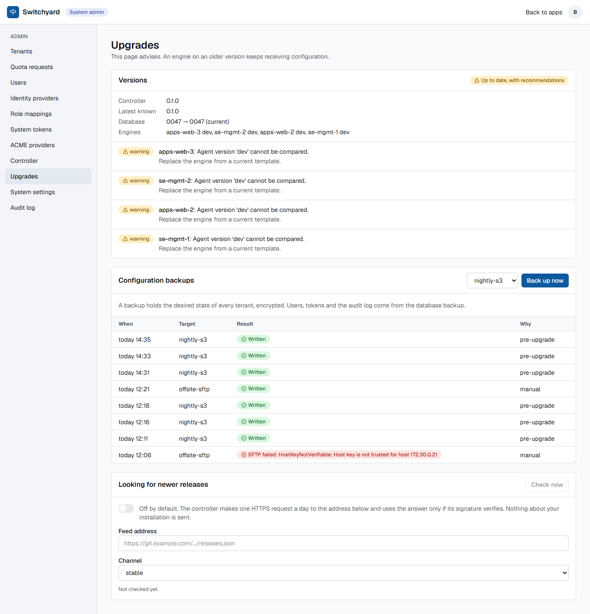
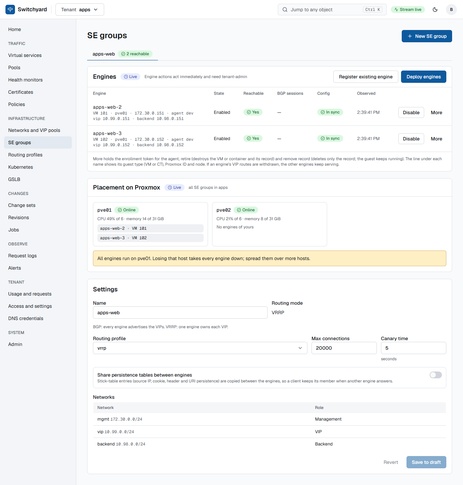
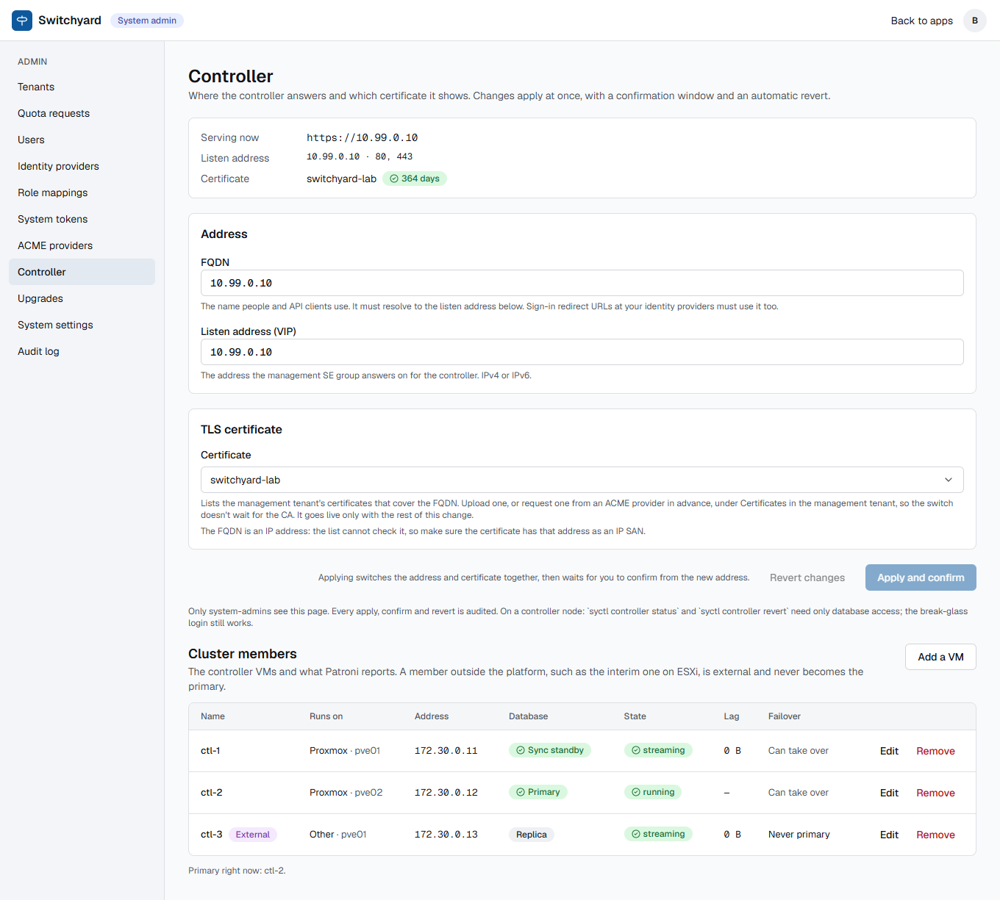

# Upgrades, backups, restore and engine roll on the production-style lab (2026-10-13)

The upgrade features of [upgrades.md](../../upgrades.md) (ADR 0205) run for the first time on real Proxmox, on the three-node
Compose install and the Helm install of [the production deployment run](../2026-10-13-prod-deploy/index.md). The same day's
gaps from that run were closed too: a three-VM Compose cluster and a restore of the database from S3 into empty nodes.

| What | Where | Result |
| --- | --- | --- |
| `syctl upgrade apply` on three controller nodes, one at a time | Compose HA, 3 privileged LXC | works, 66 to 79 s per node, the controller VIP answered 200 all the time |
| Configuration backup to S3 and to SFTP, verify | the same install | works after two fixes (SFTP host key type, S3 certificate trust is configured by you) |
| Restore of a backup into an empty controller | Helm install on k3s | works after a fix (the empty `management` tenant of a new controller no longer blocks it) |
| `helm upgrade` with a schema migration (0037 to 0047) | k3s, 2 API, 2 worker, 2 proxy pods, 3 database instances | works, 75 s including the 13 s migration Job |
| Engine roll of an SE group (two QEMU engines, VRRP) | Proxmox, pve01 | works after a fix (the group was never reapplied after the old engine left); second run clean in 6 minutes, one failed probe |
| Three-VM Compose cluster, hardened | 3 KVM VMs on 2 hosts | works; failover about 4 s |
| Database restore from S3 into empty nodes | the VM cluster | works: a wiped replica rebuilt in 20 s, and the whole cluster restored from nothing in about 6 minutes |

## Bundle upgrade of the controller nodes

The bundle was built on the workstation: controller and proxy images, the Compose file, signed with a lab key
(`syctl release keygen`, `syctl release build`). Each node took about one minute.

```text
$ syctl upgrade apply switchyard-0.1.2.sybundle --trust lab=<key> \
    --compose-file compose.yaml --compose-file compose.override.yaml --env-file node.env --backup-target nightly-s3 --yes
upgrading this node to switchyard 0.1.2
backup written: switchyard-0.1.0-20261013T161155Z.syb
  ok: bundle verified and unpacked          ok: loaded switchyard-controller:0.1.2
  ok: loaded switchyard-proxy:0.1.2         ok: env file points at the new images
  ok: schema migrated                       ok: services recreated
  ok: node healthy
```

Rolling over three nodes (16:11 to 16:19 on the lab clock), a probe of the controller VIP every three seconds got 22 answers of
200 and none else. The upgrade also moved the database from schema 0037 to 0047 on the first node while the other two were still
on the old code (migrations are additive by rule).

Gotchas, in the order you meet them:

- **`syctl` must run on the node** (it drives `docker compose` there). It needs Python 3.12 exactly (`requires-python <3.13`), and
  Debian 13 ships 3.13. What worked: `python3 -m venv` plus `pip install uv`, then `uv tool install --python 3.12 switchyard-*.whl`
  (the hosts reach PyPI and python-build-standalone through an HTTP proxy). A container image with `syctl` and the Docker CLI would
  remove this step.
- **The first upgrade over a controller that predates the feature needs `--no-backup`** and `syctl upgrade plan` answers 404, because the
  running controller has no `/system/upgrade/check` and no backup API. From the second upgrade on, both work.
- **Run the backup against an upgraded node.** `syctl api login --url` decides which controller `apply` asks for the backup. During a
  rolling upgrade point it at a node that already has the new code (the proxy port of node 1 worked: `http://<node 1>:8080`), not
  at `127.0.0.1` of a node still on the old version (which answers 404).
- **Local changes to the Compose file survive only if you name them**: `--compose-file` can now be given more than once
  (`compose.yaml` plus `compose.override.yaml`). Without it the recreated services lose the override (here: the S3 certificate).
- **The version shown is the Python package's** (`0.1.0` for every build of this lab), not the bundle's: `syctl upgrade plan` therefore said
  "you run 0.1.0" after three upgrades and warned about intermediate releases. Real releases bump the version, so this is a lab artefact.
- The engines of the lab report agent version `dev`, so the check lists a warning per engine.



The page shows the backup runs of the day, including the first SFTP attempt that failed (below) and the successful pre-upgrade backups.

## Configuration backups: S3 and SFTP

Both targets were created through the API (`POST /system/backup-targets`) with `secret_ref`s into the lab OpenBao (passphrase, S3 keys,
SFTP private key), tested, run and verified.

- **Policy.** The controller's OpenBao policy must name every platform secret: re-generate it with
  `syctl openbao-policy --shared kv/se/ --platform kv/proxmox/token --platform kv/backup/passphrase --platform kv/backup/s3-access ...`.
  The generated policy also lacked the PKI signing path (`pki/sign/agents`): anyone who used it saw engine enrollment fail with
  `OpenBao call to pki/sign/agents: HTTP 403`. The quickstart and the Helm bootstrap script appended the line by hand. It is now part
  of the generated policy.
- **S3 with a private CA.** The controller uses the system certificate store; the lab store is self-signed. A `compose.override.yaml` mounted a
  bundle (system CAs plus the store's certificate) and set `SSL_CERT_FILE` for `api` and `worker`. Use a bucket of your own for configuration
  backups (pgBackRest has its own).
- **SFTP.** The host key is pinned by fingerprint. The first run failed with `HostKeyNotVerifiable`: the SSH client negotiated an RSA host
  key and compared it with the fingerprint of the server's ed25519 key. It now tries each key family, so a fingerprint of any host key
  type works (test with a server that has all three).
- A backup of this install is 1.5 KB (the `management` tenant only), encrypted; `verify` listed `virtual_services 1, pools 1,
  se_groups 1, certificates 1`.

## Restore into an empty controller

The new Helm install (an empty `management` tenant, as `syctl serve` creates it) was the target. Restoring the backup that came from
the other controller was refused: `tenants already exist here: management`. That made the disaster-recovery use case impossible,
because every new controller starts with that tenant. A tenant of the same name that holds no configuration is now filled in place
(the restored objects take its id), while a tenant that holds configuration still refuses the whole restore.

```text
POST /system/backups/restore {"target":"offsite-sftp","archive":"switchyard-0.1.0-20261013T162128Z.syb","dry_run":true}
  200 ... "restored": false
POST /system/backups/restore { ...same, without dry_run }
  200 ... "restored": true
POST /system/backups/restore { ...same again }
  409 tenants already exist here: management
GET /tenants/management/{virtual-services,pools,se-groups,certificates,networks}
  controller · controllers · management · switchyard-lab · controller-vip, controller-vms
```

## Helm upgrade with a schema migration

`helm upgrade sy ... --set image.controller.tag=0.1.2 --set image.proxy.tag=0.1.2` over the install of the production run (schema
0037): the `sy-migrate-2` Job ran 13 s and completed, the API and worker pods waited for it and rolled one pod at a time; 75 s in all.
A second upgrade (controller 0.1.3, for the restore fix) behaved the same.

## Engine roll

A tenant `apps` with an SE group `apps-web` (VRRP, two QEMU engines on pve01, one HTTP virtual service on `10.99.0.200`) was adopted from
a YAML file; the group's `autoscale` settings (disabled, with the deploy and enroll blocks) carry what a roll needs. The group's engines
were deployed from template 9766 and enrolled. A second template, 9767, was cloned from it, and
`POST /tenants/apps/se-groups/{id}/rolls {"template_vmid": 9767}` replaced both engines, one at a time. A client probed the VIP every
second.

Three problems, in the order they showed:

1. **Enrollment never finished** (`awaiting_enrollment` for 9 minutes): the controller writes the enrollment files into the guest, and
   `guest-exec` (the `chmod` after the first file) needs the Proxmox privilege `VM.GuestAgent.Unrestricted`, which the lab's custom role
   did not have. The roll stayed in the phase and retried. After adding the privilege it went on by itself. The privileges a controller
   role needs are now listed in [production.md](../../production.md#proxmox-privileges-of-the-controller-role).
2. **The roll paused after the first engine** (`settling_after took longer than 600s`): after retiring the old engine the group's desired
   state changes (the VRRP peer list), the two remaining engines show drift, and the group score stays at 50 until the group is
   applied again. The roll did not reapply. It now has a phase `reapplying_after`. In the lab the group was reapplied by hand
   (`POST .../se-groups/{id}/reapply`) and the roll resumed (`resume`), which proved the diagnosis.
3. A deploy job was lost when the database primary stalled for about 10 seconds (below), leaving a half-created VM and an engine record
   that `retire` refused to remove ("the only enabled engine of a group that serves traffic"); removing the record and the VM by hand was
   needed.

The second roll (to template 9766, with the fix) ran by itself from 18:37 to about 18:43. Both engines were replaced, the group score
stayed at 100 between steps, and the probe logged one failed request in that time (a 2 s window at 18:39:05, around the VRRP
switch). The first roll, over 2620 probes, lost one request too.



Nothing in the UI starts or shows a roll yet; it is the API (`GET /tenants/{t}/rolls`).

## A stalled database during a template clone

While the roll test cloned a 8 GB template on the same host, etcd on the controller nodes answered slowly; Patroni's leader lock
needs etcd within the `ttl` (30 s) and `retry_timeout` (10 s), and the leader demoted itself (`demoting self because DCS is not
accessible`) and was elected again 50 s later. The API answered 500 for that time and a running deploy job died. The lab's controller nodes
share a thin-provisioned LVM volume with everything else. Put etcd and PostgreSQL on storage that is not shared with bulk copies, and
consider `retry_timeout: 20` and `ttl: 60` (`patronictl edit-config`) on shared or slow storage.

## Three-VM Compose cluster and restore from S3

Three Debian 13 VMs (2 vCPU, 3 GB, 12 GB; `vm-1` and `vm-3` on pve01, `vm-2` on pve02), Docker from the distribution, the images loaded from
tarballs, node certificates from OpenBao (`issue-node-cert.sh`), `firewall.sh`, the hardened Compose file and an S3 repository.

- Creating a VM, installing Docker and loading the images took a few minutes for the three in parallel (the apt lock is held by
  cloud-init for the first minute).
- `docker compose up`: Patroni elects a leader within a minute, the replicas come by `basebackup` (no backup exists yet at the first start; the log says
  so: `no backup sets to restore`), all three streaming after about 100 s.
- Outside a node, ports 2379, 2380, 8008 and 5432 are blocked and 8080 open. Stopping the leader's Patroni: the sync standby was leader at
  the next poll (4 s), the old leader rejoined as a replica 40 s after being started.

**Restore from S3 into an empty node.** Backups ran with `backup.sh` and WAL archiving to S3.

1. A tenant was created, a full backup taken, and a second tenant created (to prove WAL replay).
2. The data volume of replica `vm-1` was removed and Patroni started: `replica has been created using pgbackrest`, streaming 20 s later.
3. The disaster drill of [runbooks/restore-database.md](../../runbooks/restore-database.md): all three nodes stopped, the keys under
   `/switchyard/switchyard/` deleted from etcd (the command needs the client certificate now), all data volumes removed,
   `RESTORE_TARGET_TIME` set on `vm-1`: leader on timeline 2 after about two minutes; a new full backup; the other two nodes started empty
   and built themselves from it; API and workers started. Both tenants, the one created after the backup too, were there. Total about
   six minutes from stopping the cluster.

Things to know: the first run of this cluster failed because `BACKUP_S3_VERIFY_TLS=n` was missing (pgBackRest refuses the self-signed
store); the `bootstrap` then removes the data directory and Patroni restarts in a loop until the setting is there, so check
`docker compose logs patroni` early.

## Admin, Controller with an IP address as the FQDN

The page showed a red "This certificate does not cover 10.99.0.10" and an empty certificate box in the lab, where the controller is
reached by its VIP address. Certificates record DNS names only, so an address can never match and the current certificate was
filtered out of the list. With an IP address as the FQDN the page now lists every certificate, selects the current one and says that the
certificate must carry the address as an IP SAN:



## Related

[upgrades.md](../../upgrades.md) · [production.md](../../production.md) · [2026-10-13-prod-deploy](../2026-10-13-prod-deploy/index.md) ·
[runbooks/restore-database.md](../../runbooks/restore-database.md)
